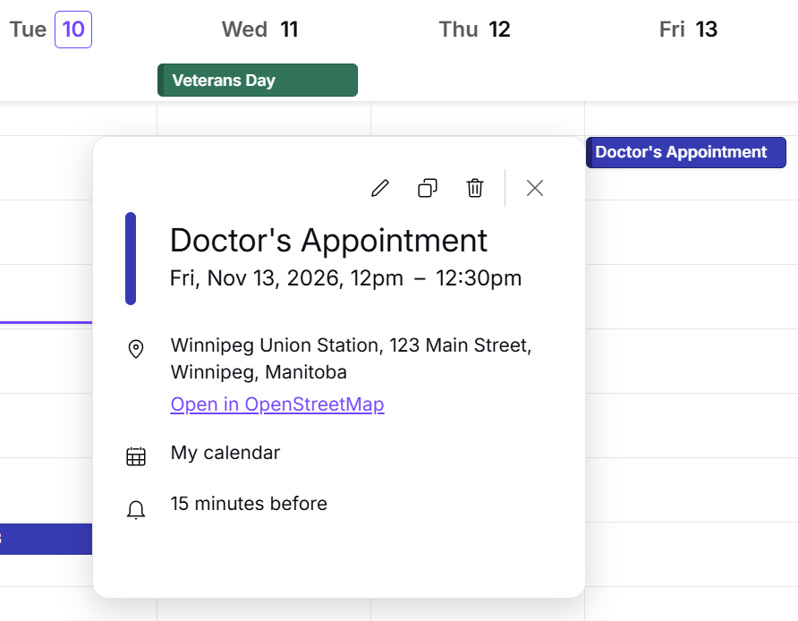
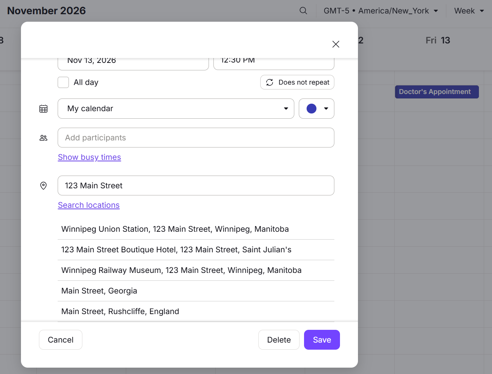

# Proton Calendar Location Enhancer

An open-source browser extension that adds location search and OpenStreetMap integration to [Proton Calendar](https://calendar.proton.me).

**Status: Experimental — Public Beta**

This is an unofficial community project and is not affiliated with or endorsed by Proton AG.

## Features

### Open locations in OpenStreetMap

When viewing an event containing a location, the extension adds an **Open in OpenStreetMap** link.

- Opens the location in a new browser tab.
- Does not modify the calendar event.
- Does not send the location to OpenStreetMap until the link is clicked.

### Search for locations

When creating or editing events, the extension adds a **Search locations** button beneath Proton Calendar's existing location field.

- Search for addresses, businesses, and points of interest.
- View matching locations from the Photon geocoding service, which uses OpenStreetMap data.
- Select a result to populate Proton Calendar's location field.
- Press Enter in the location field to initiate a search.
- Save events normally using Proton Calendar.

Location searches are initiated explicitly by the user. The extension does not automatically transmit location information while typing.

## Installation

**Beta installation (Brave and Chrome)**

The extension is not yet available through the Chrome Web Store. For now, it must be installed manually.

1. Visit the [GitHub Releases](https://github.com/dvdmon/proton-calendar-location/releases) page.
2. Open the latest beta release and download **Source code (zip)** under **Assets**.
3. Extract the downloaded ZIP file to a folder on your computer.
4. Open `brave://extensions` in Brave or `chrome://extensions` in Chrome.
5. Enable **Developer mode**.
6. Click **Load unpacked**.
7. Select the extracted folder containing `manifest.json`.
8. Open or refresh [Proton Calendar](https://calendar.proton.me).

The extension should now add location search functionality when creating or editing calendar events and OpenStreetMap links when viewing events with locations.

**Important notes:**

- Keep the extracted folder in place after installing the extension. The browser loads its files from that directory.
- If you install a newer version manually, reload the extension from the browser's Extensions page and refresh Proton Calendar.
- This is an experimental beta release and may require updates when Proton Calendar changes its interface.

## Privacy

Privacy is a primary design consideration.

- The extension operates only on Proton Calendar's website.
- It does not access Proton authentication credentials or encryption keys.
- It does not intentionally collect or transmit event titles, descriptions, attendees, or unrelated calendar information.
- Location searches are sent to the public [Photon](https://github.com/komoot/photon) service only when the user initiates a search.
- Clicking **Open in OpenStreetMap** sends the selected event's location to OpenStreetMap through the resulting navigation.
- The extension does not include analytics or tracking.
- Calendar events continue to be saved through Proton Calendar's normal functionality.

**Important:** The extension runs within Proton Calendar's webpage and can interact with its displayed content. As with any browser extension, users should review its permissions and source code before installing it.

## Known Limitations

- The extension is designed for Chromium-based browsers using Manifest V3.
- Location search quality depends on the available OpenStreetMap data and Photon geocoding results.
- Some residential addresses may be inaccurate or unavailable.
- Suite, apartment, floor, and other secondary address information may interfere with map searches. For best results, use the primary street address, city, state, and postal code.
- Search results may contain duplicate or closely related geographic features.
- The extension depends on Proton Calendar's current HTML structure and may require updates when Proton changes its interface.
- The public Photon geocoding service has no guaranteed availability. Location searches may occasionally fail due to network problems, service outages, or usage restrictions.
- The extension has initially been tested on Brave for Windows. Compatibility with other Chromium-based browsers and operating systems has not yet been verified.

## Planned Improvements

Potential future enhancements include:

- Search-as-you-type autocomplete with debouncing.
- Better search-result presentation and keyboard navigation.
- Configurable mapping and geocoding providers.
- TypeScript migration.
- Browser compatibility improvements.

These features are not guaranteed and will be prioritized based on development progress and community feedback.

## Development

The extension currently uses:

- JavaScript
- Chrome Extension Manifest V3
- Content scripts for Proton Calendar interface enhancements
- A background service worker for geocoding requests
- Photon for location search
- OpenStreetMap for map links

No build process, external JavaScript libraries, or backend server are currently required.

## Contributing and Feedback

Bug reports, suggestions, and contributions are welcome through [GitHub Issues](https://github.com/dvdmon/proton-calendar-location/issues) and pull requests.

**Beta testers:** If you encounter a problem, please include:

- Operating system and version (for example, Windows 11, macOS, or Ubuntu).
- Browser and version (for example, Brave, Chrome, or Edge).
- A brief description of what you were trying to do.
- Steps to reproduce the problem.
- What you expected to happen and what actually happened.
- Any relevant browser console errors or screenshots, if available.

Because the extension interacts directly with Proton Calendar's interface, differences in the calendar UI may also be relevant.

**Privacy note:** Please remove personal calendar details, addresses, email addresses, and other sensitive information from screenshots and console logs before sharing them publicly.

## License

This project is licensed under the MIT License. See LICENSE for details.
